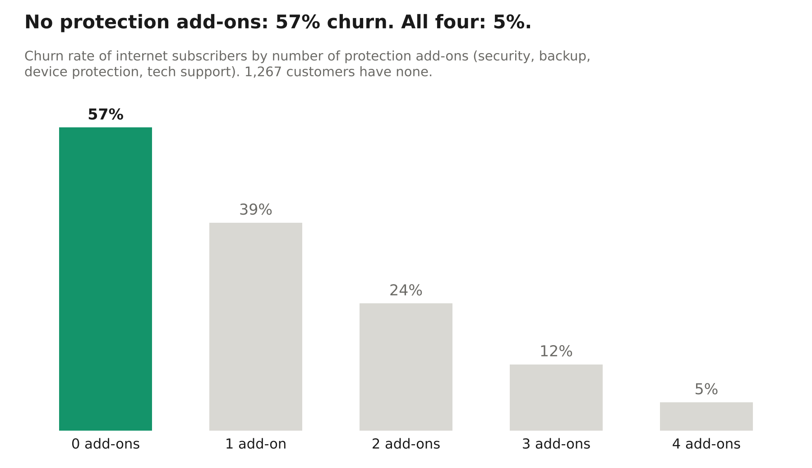
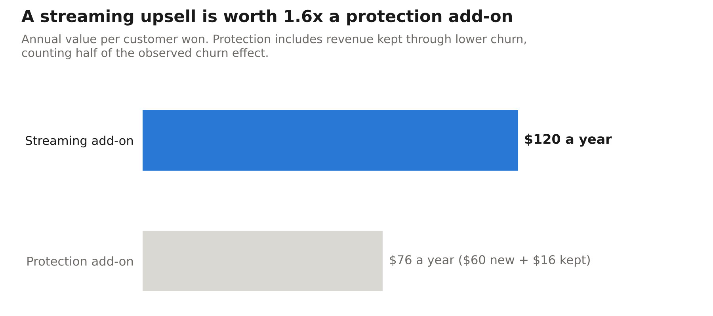

# SaaS Cross-Sell Playbook: Who Gets Which Offer, and What Is It Worth?

A customer marketing analysis of 7,043 subscribers to a multi-product subscription business. It finds which existing customers are most likely to add another product, picks a next best offer for each of them, and forecasts the pipeline. It also designs a test for the one question the data cannot answer on its own.

Built with **DuckDB SQL** and **Python (scikit-learn)**.

## The question

The business sells internet service plus six optional add-ons: four "protection" services (online security, online backup, device protection, tech support) at about $5 a month each, and two streaming services at about $10 a month each. Customer Marketing wants to grow revenue from the existing base.

**Which active customers should we target, with which offer, and what is the campaign worth?**

## The recommendation

Run two motions with different goals.

**1. Streaming upsell (revenue now).** Target 1,033 Tier 1 customers with their next best streaming offer through in-product and email programs. Each customer won is worth about $120 a year. At a 5% to 15% conversion rate, Tier 1 adds **$6,200 to $18,700 in annual value (base case $12,500)** on a base of $3.45M ARR from 3,492 active internet customers.

**2. Protection bundle retention pilot (revenue protected).** Customers without protection add-ons churn far more (57% against 5% with all four), and the gap holds after controlling for tenure and contract (each extra add-on goes with 17% lower odds of churn). But this is observational data, so it cannot prove the add-ons *cause* retention. Run a randomised pilot on the 272 newest month-to-month customers with no protection add-ons (54% predicted churn risk) before investing at scale.

| Motion | Who | Offer | Tier 1 targets | Value per win (a year) | Goal |
|---|---|---|---|---|---|
| Streaming upsell | Engaged customers, mostly 24+ months tenure | Streaming TV or Movies | 1,033 | $120 | New recurring revenue |
| Protection cross-sell | Long-tenure customers who already stream | Online Backup, Device Protection, Tech Support | 15 | $76 ($60 new + $16 kept) | Expansion and retention |
| Retention pilot | New month-to-month customers, no protection add-ons | Protection bundle (test vs control) | 272 in pilot | $60 to $89, depending on how much of the churn link is causal | Learn whether add-ons reduce churn |

## Charts



The pattern also holds within month-to-month contracts alone (59% churn with no protection add-ons, 23% with three), so contract length does not fully explain it.



Even after crediting protection add-ons with revenue kept through lower churn, streaming is the bigger revenue lever per customer won. That is why streaming leads the expansion motion and protection is tested as a retention play.

## How it works

1. **Clean and profile (SQL).** Typed customer table, adoption and churn by add-on, churn by number of protection add-ons, and the same split within each contract type ([`sql/`](sql))
2. **Recover the price list.** A linear regression of monthly charges on the services each customer holds recovers the list prices almost exactly (R² 0.999): $5.01 to $5.03 for protection add-ons, $9.96 to $9.97 for streaming
3. **Test the churn link with controls.** A logistic regression of churn on the number of protection add-ons, controlling for tenure, contract, payment method, household and other services, gives an odds ratio of 0.83 per add-on
4. **Score look-alike propensity.** For each add-on, a model predicts whether a customer has it from everything else they hold and who they are. Out-of-fold predictions (5-fold cross-validation) mean no customer is scored by a model that saw them. Cross-validated AUC is 0.74 to 0.80
5. **Choose a next best offer.** For each active customer and each add-on they lack: expected annual value = propensity × (new revenue + retained revenue). The highest expected value wins. Retained revenue counts only half of the modelled churn reduction, because the link is not proven to be causal
6. **Prioritise and forecast.** Tier 1 = top 30% of expected value. The forecast applies 5%, 10% and 15% conversion rates, which are planning assumptions to replace with real campaign benchmarks

## Segment playbook

| Contract | Tenure | Active customers | Avg churn risk | Tier 1 targets | Lead motion | Lead offer |
|---|---|---|---|---|---|---|
| Month-to-month | 0 to 11 months | 632 | 48% | 75 | Streaming upsell | Streaming Movies |
| Month-to-month | 12 to 23 months | 389 | 43% | 87 | Streaming upsell | Streaming TV |
| Month-to-month | 24 to 47 months | 507 | 33% | 140 | Streaming upsell | Streaming Movies |
| Month-to-month | 48+ months | 262 | 23% | 90 | Protection cross-sell | Online Backup |
| One year | 24 to 47 months | 325 | 16% | 119 | Streaming upsell | Streaming Movies |
| One year | 48+ months | 479 | 11% | 205 | Protection cross-sell | Device Protection |
| Two year | 48+ months | 647 | 4% | 264 | Protection cross-sell | Tech Support |

Smaller segments are in [`results/segment_playbook.csv`](results/segment_playbook.csv). The full target list, with each customer's offer, propensity, value and tier, is in [`results/next_best_offer_targets.csv`](results/next_best_offer_targets.csv).

## Retention pilot design

- **Population:** 272 active month-to-month customers in their first year with no protection add-ons
- **Design:** randomly split 50/50. The test group gets a protection bundle offer; control gets nothing new
- **Primary metric:** 90-day churn rate, test vs control. Secondary: bundle take-up rate, revenue per customer
- **Decision rule:** scale the bundle to all high-risk new customers if test churn is meaningfully lower than control and the value per customer exceeds the cost of the offer
- **Caveat:** 272 customers can only detect a large effect. If the pilot is inconclusive, extend it to the next cohort of new customers before deciding

## What I would do next

- **Replace assumed conversion rates** with real benchmarks from past in-product and email campaigns
- **Model contract upgrades** as a third motion, since contract length is the strongest churn driver in the data
- **Add customer lifetime value** so retention value covers more than one year
- **Check offer fatigue:** cap how many offers a customer sees per quarter across all motions

## Repository structure

```
sql/
  01_clean.sql                  typed customer table and internet customer view
  02_adoption_and_churn.sql     adoption, churn by add-on, churn by protection count and contract
  03_segments.sql               active customer segments
scripts/
  get_data.sh                   download the dataset
  run_all.py                    SQL, price model, churn model, propensity, next best offer, forecast
  make_charts.py                README charts
results/                        CSV outputs, including the full target list
charts/                         README charts
```

## How to run it

```bash
pip install duckdb pandas scikit-learn matplotlib
bash scripts/get_data.sh
python scripts/run_all.py
python scripts/make_charts.py
```

## Limitations

- **Cross-sectional data.** The dataset is a single snapshot, so propensity is based on look-alikes (customers who resemble adopters) rather than observed purchase events over time
- **Correlation, not causation, for churn.** Longer-tenured customers hold more add-ons and churn less; controls reduce but cannot remove this. The pilot exists to settle it
- **Small sample.** 7,043 customers, so absolute dollar figures are small. The method and the relative sizes of the opportunities are the point, and both scale to a real customer base
- **No offer costs.** Discounts, campaign costs and margin are not in the data, so values are revenue, not profit

## Data source and licence

Data: IBM Telco Customer Churn sample dataset, from [IBM/telco-customer-churn-on-icp4d](https://github.com/IBM/telco-customer-churn-on-icp4d) (Apache License 2.0). Code in this repository is MIT licensed.
