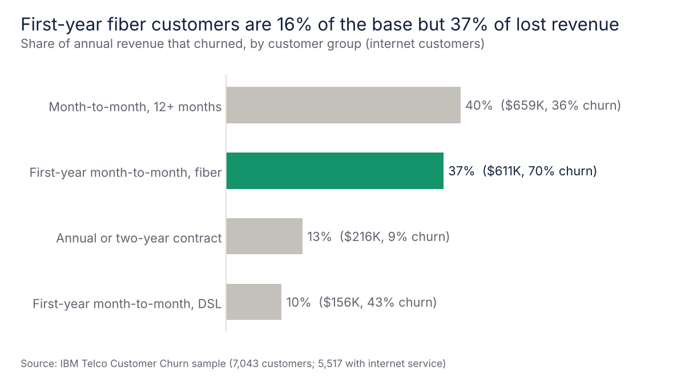
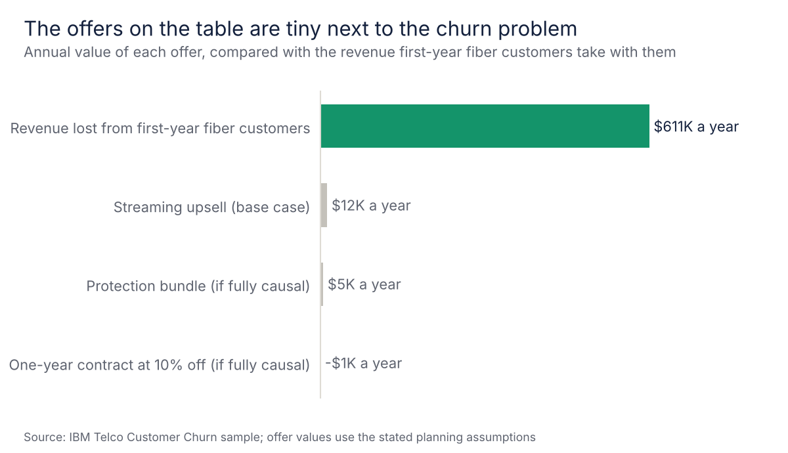

# SaaS Cross-Sell Playbook: Is Cross-Sell Where the Revenue Is?

A customer marketing analysis of 7,043 subscribers to a multi-product subscription business. Customer Marketing asked for a cross-sell plan. The analysis builds one, then checks whether it is the right lever, and finds that churn among new fiber customers matters far more than any offer on the table.

Built with **DuckDB SQL** and **Python (scikit-learn)**.

## The question

The business sells internet service plus six optional add-ons: four "protection" services (online security, online backup, device protection, tech support) at about $5 a month each, and two streaming services at about $10 a month each. Customer Marketing wants to grow revenue from the existing base through cross-sell.

**Which customers should get which offer, and is cross-sell where the money is?**

## The answer

**Cross-sell is worth about $12K a year. Churn from just one group, new fiber customers on month-to-month plans, costs fifty times that.**

1. **Run the upsell, but only as a low-cost, always-on program.** The best cross-sell motion (streaming upsell to 1,033 Tier 1 customers) adds about **$12,500 a year at a 10% conversion rate, 0.4% of the $3.45M ARR.** Worth doing in-product, not worth a major campaign
2. **Make first-year fiber churn the priority.** First-year month-to-month fiber customers are **16% of internet customers but 37% of churned revenue: $611K a year, at a 70% churn rate.** They churn at 63% to 81% whatever payment method they use, while first-year DSL customers churn at 28% to 51%, which points to the fiber product or its price rather than billing
3. **Don't use add-ons or contract discounts as the retention fix.** One extra protection add-on is linked to about 4 points lower churn, so a protection bundle is worth $3,300 to $5,000 a year even if the link is fully causal. A one-year contract at 10% off loses money in every scenario tested, because the discount costs more than the churn it would prevent
4. **Find out why new fiber customers leave before choosing a fix.** This dataset cannot separate price from service quality. Exit reasons, support tickets, outage logs and a competitor price check would. Then test the fix properly: detecting a 10-point drop in first-year fiber churn needs about **351 customers per group**
5. **Drop the 272-customer protection pilot.** It can only detect a 17-point drop in churn. The effect the data suggests (about 4 points) would need about 2,300 customers per group, more than the business has in that segment

**What would change the answer:** exit or survey data showing that new fiber customers leave over something an add-on or contract fixes, or a real churn effect from add-ons much larger than this observational data suggests.

## Charts





## Results

### Where churned revenue comes from (internet customers)

| Group | Customers | Churn rate | Annual revenue churned | Share of churned revenue |
|---|---|---|---|---|
| Month-to-month, 12+ months | 1,815 | 36% | $659K | 40% |
| **First-year month-to-month, fiber** | **876** | **70%** | **$611K** | **37%** |
| Annual or two-year contract | 2,166 | 9% | $216K | 13% |
| First-year month-to-month, DSL | 660 | 43% | $156K | 10% |

Source: [`results/churned_revenue_by_group.csv`](results/churned_revenue_by_group.csv). Churn by internet type and payment method for first-year customers: [`results/first_year_churn_by_internet_and_payment.csv`](results/first_year_churn_by_internet_and_payment.csv)

### What each offer is worth (annual)

| Offer | Who | Assumptions | Annual value |
|---|---|---|---|
| Streaming upsell | 1,033 Tier 1 customers | 10% conversion, $120 a year per win | $12,468 |
| Protection bundle | 549 active customers with no protection add-ons | 10% take-up; 0% to 100% of the churn link causal | $3,307 to $4,980 |
| One-year contract at 10% off | 1,795 month-to-month customers | 15% take-up; 25% to 100% of the model's churn cut causal | -$17,507 to -$1,044 |

Sources: [`results/pipeline_forecast_by_offer.csv`](results/pipeline_forecast_by_offer.csv), [`results/bundle_scenarios.csv`](results/bundle_scenarios.csv), [`results/contract_offer_scenarios.csv`](results/contract_offer_scenarios.csv)

### Can a test settle it?

| Test | Effect to detect | Customers needed per group | Feasible? |
|---|---|---|---|
| Protection bundle pilot (as first planned, 272 customers) | Can only detect a 17-point drop | 136 available | No: the likely effect is about 4 points |
| Protection bundle, to detect the likely 4-point effect | 4.1 points | 2,283 | No: more than the segment holds |
| First-year fiber retention test | 10 points (from 70%) | 351 | Yes, within a few months of new customers |

Sources: [`results/pilot_power.csv`](results/pilot_power.csv), [`results/fiber_test_size.csv`](results/fiber_test_size.csv). Two-sided test at 5% significance and 80% power.

## The cross-sell plan, if you run it

The original playbook still stands as the low-cost upsell program in recommendation 1.

### How it works

1. **Clean and profile (SQL).** Typed customer table, adoption and churn by add-on, churn by number of protection add-ons, and the same split within each contract type ([`sql/`](sql))
2. **Recover the price list.** A linear regression of monthly charges on the services each customer holds recovers the list prices almost exactly (R² 0.999): $5.01 to $5.03 for protection add-ons, $9.96 to $9.97 for streaming
3. **Test the churn link with controls.** A logistic regression of churn on the number of protection add-ons, controlling for tenure, contract, payment method, household and other services, gives an odds ratio of 0.83 per add-on
4. **Score look-alike propensity.** For each add-on, a model predicts whether a customer has it from everything else they hold and who they are. Out-of-fold predictions (5-fold cross-validation) mean no customer is scored by a model that saw them. Cross-validated AUC is 0.74 to 0.80
5. **Choose a next best offer.** For each active customer and each add-on they lack: expected annual value = propensity × (new revenue + retained revenue). The highest expected value wins. Retained revenue counts only half of the modelled churn reduction, because the link is not proven to be causal
6. **Prioritise and forecast.** Tier 1 = top 30% of expected value. The forecast applies 5%, 10% and 15% conversion rates, which are planning assumptions to replace with real campaign benchmarks

### Segment playbook

| Contract | Tenure | Active customers | Avg churn risk | Tier 1 targets | Lead motion | Lead offer |
|---|---|---|---|---|---|---|
| Month-to-month | 0 to 11 months | 632 | 48% | 75 | Streaming upsell | Streaming Movies |
| Month-to-month | 12 to 23 months | 389 | 43% | 87 | Streaming upsell | Streaming TV |
| Month-to-month | 24 to 47 months | 507 | 33% | 140 | Streaming upsell | Streaming Movies |
| Month-to-month | 48+ months | 262 | 23% | 90 | Protection cross-sell | Online Backup |
| One year | 24 to 47 months | 325 | 16% | 119 | Streaming upsell | Streaming Movies |
| One year | 48+ months | 479 | 11% | 205 | Protection cross-sell | Device Protection |
| Two year | 48+ months | 647 | 4% | 264 | Protection cross-sell | Tech Support |

Smaller segments are in [`results/segment_playbook.csv`](results/segment_playbook.csv). The full target list, with each customer's offer, propensity, value and tier, is in [`results/next_best_offer_targets.csv`](results/next_best_offer_targets.csv).

## What I would do next

- **Replace assumed conversion rates** with real benchmarks from past in-product and email campaigns
- **Diagnose first-year fiber churn** with exit reasons, support tickets and outage data, then run the sized retention test
- **Add customer lifetime value** so retention value covers more than one year
- **Check offer fatigue:** cap how many offers a customer sees per quarter across all motions

## Repository structure

```
sql/
  01_clean.sql                  typed customer table and internet customer view
  02_adoption_and_churn.sql     adoption, churn by add-on, churn by protection count and contract
  03_segments.sql               active customer segments
scripts/
  get_data.sh                   download the dataset
  run_all.py                    SQL, price model, churn model, propensity, next best offer, forecast
  make_charts.py                README charts
  brand_style.py                shared chart style
results/                        CSV outputs, including the full target list
charts/                         README charts
```

## How to run it

```bash
pip install duckdb pandas scikit-learn matplotlib
bash scripts/get_data.sh
python scripts/run_all.py
python scripts/make_charts.py
```

## Limitations

- **Cross-sectional data.** The dataset is a single snapshot, so propensity is based on look-alikes (customers who resemble adopters) rather than observed purchase events over time
- **Correlation, not causation, for churn.** Longer-tenured customers hold more add-ons and churn less; controls reduce but cannot remove this, which is why every churn effect is shown at several causal shares
- **Small sample.** 7,043 customers, so absolute dollar figures are small. The relative sizes of the opportunities are the point, and they scale to a real customer base
- **Unknown period.** The dataset flags customers who left during the period it covers, so churned revenue is annualised from their monthly charges
- **No offer costs.** Discounts, campaign costs and margin are not in the data, so values are revenue, not profit

## Data source and licence

Data: IBM Telco Customer Churn sample dataset, from [IBM/telco-customer-churn-on-icp4d](https://github.com/IBM/telco-customer-churn-on-icp4d) (Apache License 2.0). Code in this repository is MIT licensed.
